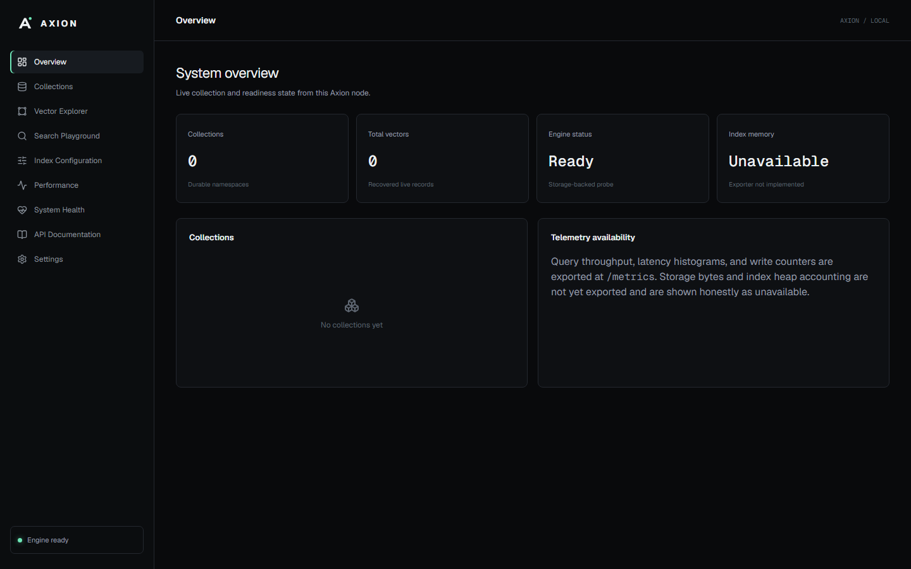
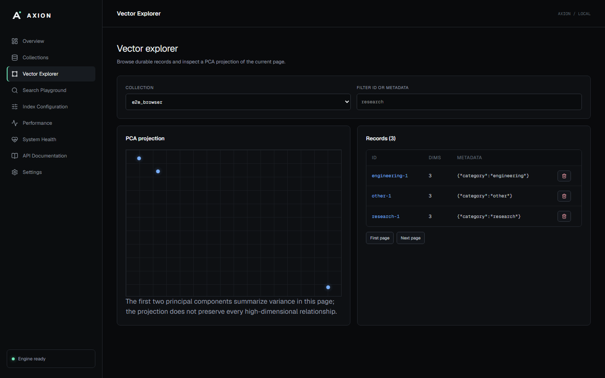
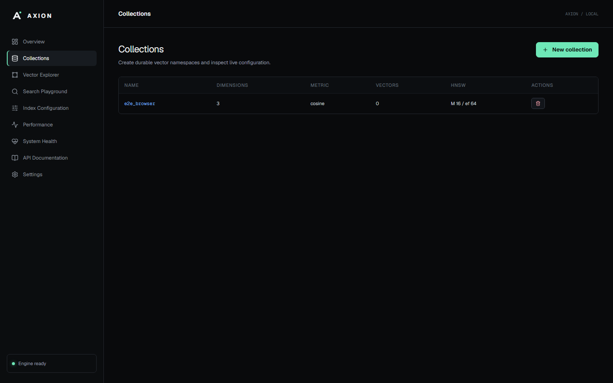
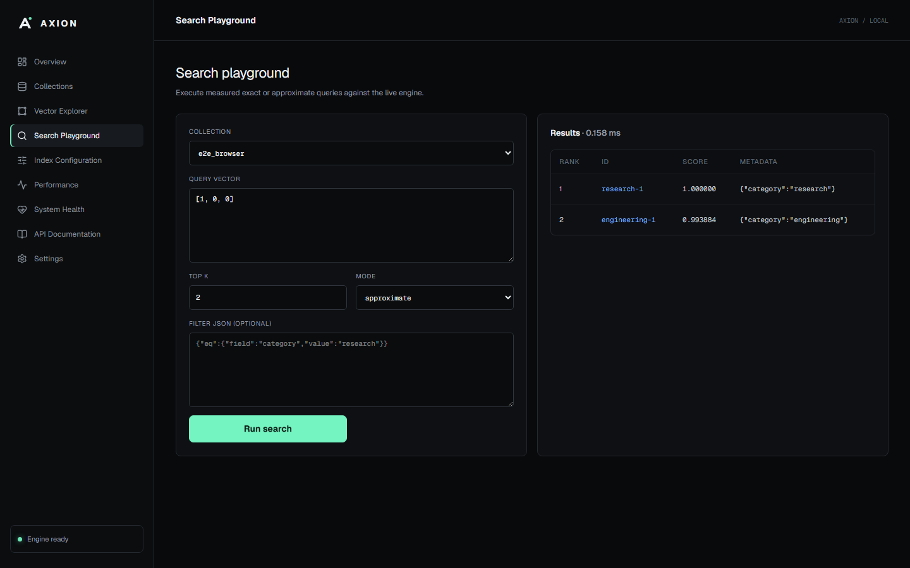
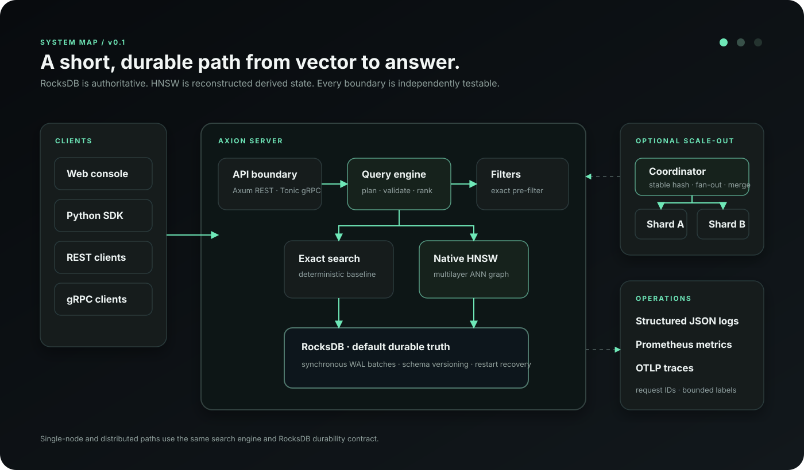
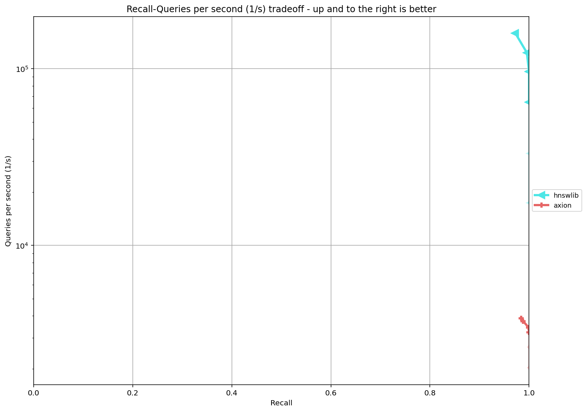

<p align="center">
  
</p>

<p align="center"><strong>Vector search, engineered from first principles.</strong></p>

<p align="center">
  A durable Rust vector engine with native HNSW, RocksDB, REST and gRPC APIs,<br />
  a typed Python SDK, an operational web console, and validated Docker and Kubernetes paths.
</p>

<p align="center">
  <a href="https://github.com/jonxsong/Axion/actions/workflows/ci.yml"></a>
  <a href="LICENSE"></a>
  
  
  
</p>

<p align="center">
  <a href="https://axion-vector-search.perkyaisle4.chatgpt.site">Website</a> ·
  <a href="docs/guides/quickstart.md">Quickstart</a> ·
  <a href="docs/README.md">Documentation</a> ·
  <a href="docs/architecture/README.md">Architecture</a> ·
  <a href="benchmarks/results/20261115-224055/README.md">Benchmarks</a> ·
  <a href="CONTRIBUTING.md">Contributing</a>
</p>

---

Axion is an open-source vector search system for teams that want the performance of approximate nearest-neighbor search without hiding durability, recall, or failure semantics behind a black box. Its HNSW graph is implemented in Rust. Its records are committed to RocksDB with synchronous WAL writes. Exact search remains available as a correctness oracle, and every published performance comparison carries reproducible evidence.

The initial `0.1.0` release is production-oriented for single-node workloads and includes an optional partitioned coordinator for horizontal search. The coordinator deliberately does not claim replication or consensus; its boundaries are documented below.

## What ships

| Surface | Contract |
| --- | --- |
| Search | Cosine, Euclidean, and dot-product scoring; exact and native multilayer HNSW; deterministic tie ordering |
| Data | Collection/vector CRUD, atomic batch upserts, JSON metadata, boolean filters, bounded pagination |
| Durability | **RocksDB by default**, synchronous WAL batches, versioned keys, fail-closed schema checks, deterministic HNSW recovery |
| APIs | Axum REST with OpenAPI 3.1 and Tonic gRPC with versioned protobufs |
| Clients | Typed synchronous and asynchronous Python 3.12+ SDK |
| Product | Responsive Next.js console for collections, PCA vector exploration, search, health, and performance |
| Operations | JSON logs, request IDs, Prometheus metrics, optional OTLP traces, liveness/readiness probes |
| Deployment | Hardened multi-stage images, Compose, kind-validated Kubernetes manifests, persistent volumes |
| Evaluation | Criterion microbenchmarks and an official ANN-Benchmarks adapter with standardized datasets |
| Scale-out | Deterministic single-owner sharding, parallel fan-out, stable global merge, explicit partial results |

## See it

| Overview | Vector explorer |
| --- | --- |
|  |  |

| Collections | Search playground |
| --- | --- |
|  |  |

These screenshots come from the Playwright acceptance flow against the real Rust backend—not a mocked product shell.

## Architecture



The server keeps one dependency direction: API boundaries validate requests; the collection engine plans and synchronizes operations; exact or HNSW indexes score candidates; RocksDB owns durable truth. On restart, Axion rebuilds the derived graph from records in deterministic ID order.

The optional stateless coordinator assigns each vector ID to one shard, searches all available shards in parallel, and merges candidates by score then ID. Read [the consistency model](docs/architecture/distributed-search.md) before using it: there is no replication, consensus, automatic failover, or automatic rebalancing in `0.1.0`.

## Five-minute start

Docker Desktop with Compose v2 is the shortest supported path:

```bash
git clone https://github.com/jonxsong/Axion.git
cd Axion
docker compose up --build -d
```

- Console: `http://localhost:3000`
- REST: `http://localhost:8080`
- Swagger UI: `http://localhost:8080/docs`
- gRPC: `localhost:50051`
- Metrics: `http://localhost:8080/metrics`

Create and query a collection:

```bash
curl -X POST http://localhost:8080/v1/collections \
  -H 'content-type: application/json' \
  -d '{"name":"documents","dimensions":3,"metric":"cosine"}'

curl -X POST http://localhost:8080/v1/collections/documents/vectors \
  -H 'content-type: application/json' \
  -d '{"id":"doc-1","values":[1,0,0],"metadata":{"team":"search"}}'

curl -X POST http://localhost:8080/v1/collections/documents/search \
  -H 'content-type: application/json' \
  -d '{"vector":[1,0,0],"top_k":5,"mode":"approximate"}'
```

Or use the typed Python client:

```bash
python -m pip install -e './sdks/python'
```

```python
from axion_client import AxionClient

with AxionClient("http://localhost:8080") as client:
    client.create_collection("documents", dimensions=3, metric="cosine")
    client.upsert("documents", [{
        "id": "doc-1",
        "values": [1.0, 0.0, 0.0],
        "metadata": {"team": "search"},
    }])
    print(client.search("documents", [1.0, 0.0, 0.0], top_k=5).results)
```

See the [full quickstart](docs/guides/quickstart.md), [configuration reference](docs/guides/configuration.md), and [semantic-search example](examples/semantic_search.py).

## Measured search

Axion is wired into the official [`erikbern/ann-benchmarks`](https://github.com/erikbern/ann-benchmarks) framework. The committed comparison used its standard `random-xs-20-euclidean` dataset (9,000 train vectors, 1,000 queries, recall@10), three timed runs, and one pinned CPU for each implementation.



| Axion `ef_search` | Recall@10 | Queries/s |
| ---: | ---: | ---: |
| 8 | 0.9840 | 3,873.9 |
| 16 | 0.9880 | 3,730.2 |
| 32 | 0.9990 | 3,440.4 |
| 64 | 1.0000 | 3,217.6 |

This is intentionally end-to-end: Axion goes through HTTP JSON and RocksDB metadata retrieval, while the comparison hnswlib adapter runs in process. It is useful systems evidence, not a claim of index-only parity. Raw CSV, all breadth settings, host metadata, exact revisions, and interpretation are in the [result artifact](benchmarks/results/20261115-224055/README.md). Reproduce it with `make ann-benchmarks`; use Criterion for Rust component measurements.

## Deploy with confidence

The default Compose path uses a non-root, read-only runtime container and a named RocksDB volume. The Kubernetes base includes:

- Axion and web Deployments plus Services
- ConfigMap and external Secret references
- a 2 GiB `ReadWriteOnce` persistent volume claim
- startup, readiness, and liveness probes
- CPU/memory requests and limits
- restricted pod/container security contexts
- `Recreate` rollout semantics for single-writer storage

`make kind-test` builds and loads the real images into kind, performs authenticated writes, deletes the live server pod, waits for its replacement, and verifies the pre-replacement vector from the same PVC. See the [Kubernetes guide and recorded validation](deploy/kubernetes/README.md).

## Validation matrix

```text
make check              Rust, Python, and web formatting/lint/tests/build
make compose-test       real API write + container restart persistence
make distributed-test   two shards + failure + partial results + recovery
make ann-benchmarks     official comparative recall-versus-QPS run
make kind-test          kind deployment + pod replacement persistence
make e2e                Playwright against the real Compose backend
```

CI repeats strict Rust, Python, web, dependency-audit, and production-image gates on every pull request. The [implementation ledger](docs/IMPLEMENTATION_PLAN.md) only marks work complete after the associated workflow has actually passed; the [log](docs/IMPLEMENTATION_LOG.md) records the evidence and limitations.

## Security and operational boundaries

Use `AXION_API_KEY` (or a Kubernetes Secret) for bearer authentication, terminate TLS at a trusted ingress, retain restrictive CORS, and back up the volume at the storage layer. Axion never exposes raw internal storage errors in public REST responses. Read the [threat model](docs/security/threat-model.md), [observability guide](docs/guides/observability.md), and [security policy](SECURITY.md) before an exposed deployment.

RocksDB permits one process per data directory. The distributed coordinator partitions but does not replicate data. Hardware and filesystem guarantees still bound synchronous-WAL durability. Those are design contracts, not footnotes.

## Project layout

```text
crates/          core math, HNSW, RocksDB, query, APIs, server, coordinator
apps/web/        landing page and operational console
sdks/python/     typed sync/async client
proto/           versioned gRPC contract
deploy/          Compose support, Prometheus, Kubernetes manifests
benchmarks/      Criterion code, ANN-Benchmarks adapter, result evidence
docs/            guides, architecture, ADRs, API and security references
scripts/         executable acceptance workflows
```

Contributions are welcome. Start with [CONTRIBUTING.md](CONTRIBUTING.md) and preserve the project's central rule: claims follow executable evidence. Axion is available under the [MIT License](LICENSE).
