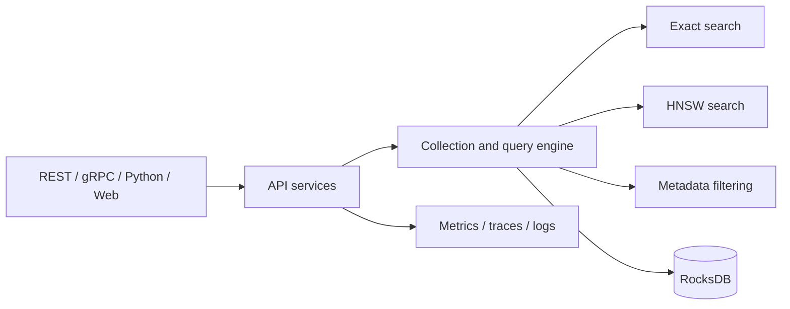

# Architecture

Axion follows a strict dependency direction:

Detailed component, persistence, recovery, query, and distributed-search diagrams will evolve with the corresponding tested implementation. The public SVG is generated only from the architecture that exists in code.

