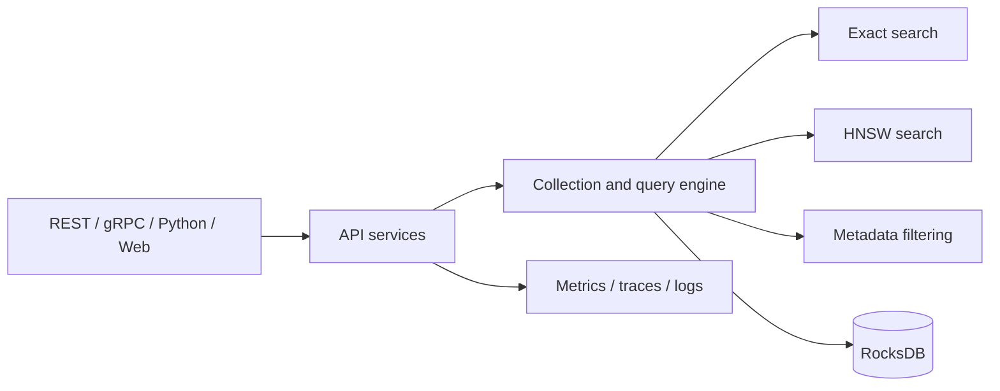

# Architecture

Axion follows a strict dependency direction:

See [storage and recovery](storage.md) and [distributed search](distributed-search.md) for the tested persistence and multi-node consistency models. The public SVG documents only architecture that exists in code.

