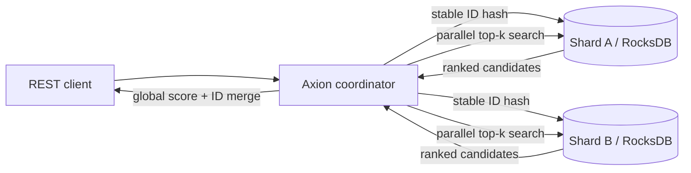

# Distributed search

Axion includes an optional stateless coordinator for partitioning writes and fanning searches out across independent Axion servers. The single-node server remains the simplest production topology; the coordinator is for datasets or request volumes that need horizontal partitioning.



## Consistency model

- Each vector ID has exactly one owner, selected with deterministic FNV-1a hashing over the sorted shard-name list.
- Collection creation and deletion are sent to every shard. Batch upserts are partitioned by ID and sent only to the owning shards.
- Mutations succeed only when every targeted shard succeeds. A request can still have partially committed before a failure, so clients must retry mutations with the same IDs. Upserts and collection creation are idempotent for that recovery path.
- Searches run concurrently on all shards. Results are deduplicated by ID and globally ordered by score, then ID for stable ties.
- `AXION_MIN_SEARCH_SHARDS` controls availability. If the minimum responds, the coordinator returns results with `partial`, `successful_shards`, and `failures` fields. Below the minimum it returns `503`.

## Operational boundaries

This topology is partitioning, not replication. It does not provide consensus, automatic replicas, leader election, or zero-data-loss failover. A shard outage makes that shard's owned vectors temporarily unavailable. Back up each shard independently.

The ordered shard-name set is part of the data placement contract. Adding, removing, or renaming nodes remaps IDs; Axion does not yet rebalance existing data automatically. Keep the node set fixed or perform an application-managed export and reingestion.

## Local validation

Run the same two-shard failure and persistence test used by the project:

```powershell
./scripts/distributed-smoke.ps1
```

It builds the production image, creates a collection through the coordinator, verifies writes are partitioned exactly once, stops a shard and validates partial-result metadata, restarts both shards, and confirms RocksDB persistence. The isolated test project removes its containers and volumes when complete.

For manual exploration:

```powershell
docker compose -f deploy/docker-compose.distributed.yml up --build -d
```

The coordinator listens on `http://localhost:18090`; shard inspection ports are `18091` and `18092`. The local-only example keys are `local-coordinator-key` and `local-shard-key`. Replace them with managed secrets outside local development.
